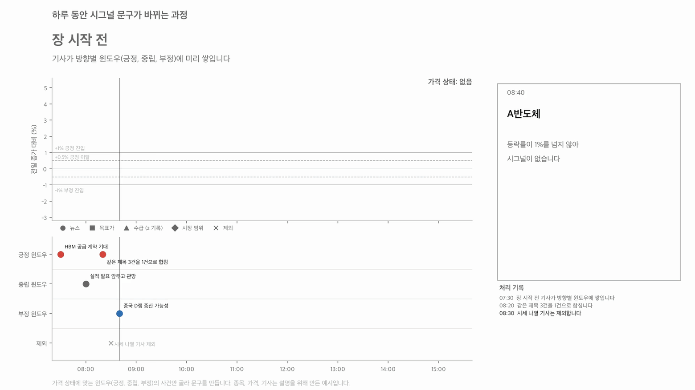
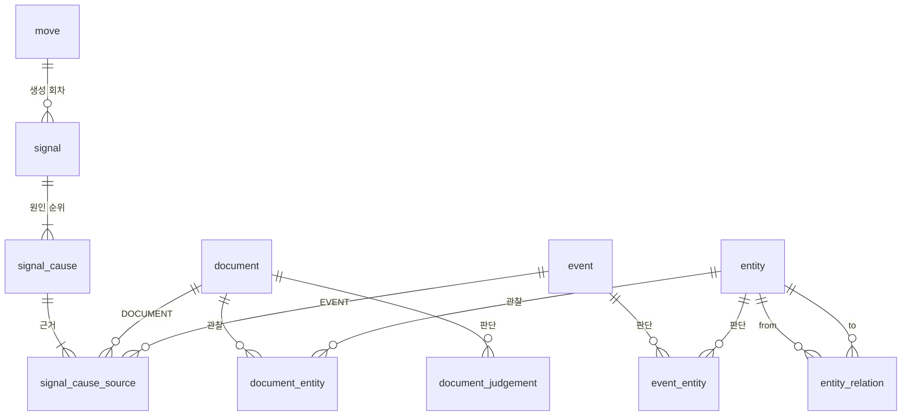
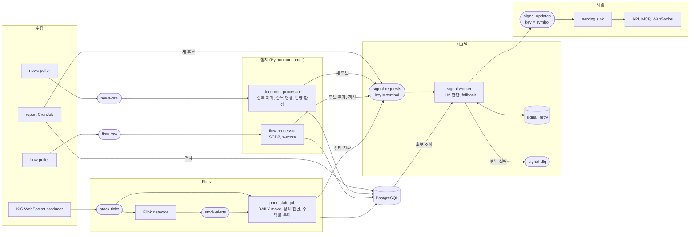

# 22. AI 시그널 기능 명세

## 배경

- 목표는 토스증권 "AI 시그널"과 같은 기능을 구현하는 것입니다.
- AI 시그널은 주가가 왜 올랐는지, 왜 떨어졌는지를 짧은 문장으로 알려 줍니다.
- 핵심은 "{원인}(으)로 N% 상승/하락" 문구를 제공하고, 원인 이벤트를 최대 3개까지 제공합니다.
- 이 기능을 만들려면 뉴스, 소셜, 공시 데이터를 실시간으로 모아야 합니다.
- 그리고 LLM으로 그 데이터를 요약하고, 분석하고, 필요한 정보를 추출해야 합니다.

예시: AI 수익성 우려로 삼성전자 9.9% 하락
1. 미국 물가 지표 충격으로 고금리 부담이 커지고 AI 인프라 투자 수익성에 대한 회의론이 확산하면서 삼성전자를 포함한 반도체주 전반에 매도세가 몰렸어요.
2. 외국인이 코스피에서 대규모 순매도를 이어간 가운데 메모리 반도체 경쟁 심화 우려와 국내 증시의 반도체 쏠림 구조가 겹치면서 삼성전자 낙폭이 커졌어요.

## 한눈에 보기



- 가격 상태(긍정, 중립, 부정)가 바뀌면, 그 상태에 맞는 윈도우의 사건으로 문구를 다시 만듭니다.
- 종목, 가격, 기사는 설명을 위해 만든 예시입니다.
- 고화질 영상: [ai-signal-scenario.mp4](figures/ai-signal-scenario.mp4)
- 생성 코드: `scripts/figures/ai_signal/render.py`

## 요약

- 이 문서는 가격 급변에 "관련 소식"을 연결하는 데이터 모델을 정의합니다.
- 저장소는 PostgreSQL만 사용하고, Neo4j는 사용하지 않습니다.
- 각 절의 상태 표시는 다음과 같습니다.
  - **[합의]**: 결정이 끝난 내용입니다.
  - **[제안]**: 아직 합의하지 않은 내용입니다.
  - **[미정]**: 다음에 결정할 내용입니다.

## 1. 목표

### 1.1 만들 결과

가격이 급변하면, 그 급변과 관련된 이벤트를 찾아서 연결합니다.

```
SK하이닉스  -10.2%
중국 메모리 경쟁 우려로 반도체 업종 급락
```

### 1.2 원칙

1. 이 기능은 가격 변동과 관련된 소식을 보여 줍니다.
2. 가격이 먼저 움직이고 기사가 나중에 나오는 경우가 많습니다. 그래서 모든 연결에 대해, 원인이 가격보다 먼저 알려졌는지(선행) 나중에 알려졌는지(후행)를 기록합니다.
3. 근거가 약하면 문구를 보여 주지 않습니다. 틀린 설명은 사용자의 판단을 해치기 때문입니다.
4. 시그널은 가격 변동과 관련된 소식을 모아 원인을 요약한 결과입니다.

### 1.3 이 설계가 필요한 이유

2026-10-13에 KIS 종합 시황/공시(제목) API로 SK하이닉스(000660)의 기사 169건을 수집했습니다. 다음 문제를 확인했습니다.

| 관찰 | 수치 | 설계에 주는 영향 |
| --- | --- | --- |
| 원천 종목 태그가 000660인 기사 | 169건 중 50건 (30%) | 원천이 붙인 태그만으로는 기사와 종목을 충분히 연결할 수 없습니다 |
| 기사당 종목 태그 수 | 169건 모두 1개 | 두 종목을 다룬 기사도 한 종목에만 연결됩니다 |
| 같은 일련번호에서 제목이 바뀐 기사 | 1건 확인 | 문서의 변경 이력을 버전으로 관리해야 합니다 |
| 같은 제목의 중복 기사 | 12건 | 같은 사건을 다룬 기사를 묶어서 판단해야 합니다 |
| 시장 시황 기사 | 169건 중 78건 | 시장 요인과 종목 요인을 나눠야 합니다 |

## 2. 주요 다이어그램

### ER-Diagram



### Data flowchart



| 관계 | 의미 |
| --- | --- |
| `document_entity` | 관찰: 이 기사에 이 엔티티가 나옵니다 |
| `document_judgement` | 판단: 이 기사의 방향과 범위입니다 |
| `event`, `event_entity` | 구조화 이벤트(목표가 변경, 수급)와 그 대상입니다. 데이터 1건이 그 자체로 이벤트 1건입니다 |
| `signal`, `signal_cause`, `signal_cause_source` | 시그널: 이 급변의 원인 요약과 그 근거입니다 |
| `entity_relation` | 관계: 엔티티 사이의 구조 정보입니다 |

- 기사를 사건으로 묶는 별도 단계(클러스터링)는 두지 않습니다.
- 시그널을 생성할 때 LLM이 같은 방향의 기사를 한 번에 읽고, 같은 사건끼리 묶고, 원인을 고릅니다.
- 묶음 결과는 시그널(`signal_cause`)에 남습니다. 오래 유지되는 사건 식별자가 필요해지면 이 결과를 모아서 나중에 만듭니다.

## 3. 테이블 구조 규칙 [합의]

- 유형이 여러 개인 테이블은 공통 테이블과 서브타입 테이블로 나눕니다. 이 방식을 class table inheritance라고 합니다.
- 공통 테이블에는 모든 유형이 공유하는 필드만 둡니다.
- 서브타입 테이블은 공통 테이블과 1:1로 연결합니다. 서브타입의 PK는 공통 테이블의 FK입니다.
- 유형별 필드에 JSON 컬럼을 사용하지 않습니다. 타입과 NOT NULL 제약으로 값을 보호합니다.
- 새 유형을 추가할 때는 서브타입 테이블을 하나 추가합니다. 공통 테이블은 바꾸지 않습니다.

이 규칙은 `entity`, `document`, `event`에 적용합니다.

## 4. 엔티티 [합의]

### 4.1 엔티티 테이블

```
entity              entity_id PK, entity_type, name
 +- entity_symbol   국내 상장 종목 (ticker, market)
 +- entity_sector   섹터 (분류 체계, 코드, 레벨)
 +- entity_market   시장 (KOSPI, KOSDAQ, US 등)
 +- entity_org      외부 기업과 기관 (CXMT, 연준, 마이크론 등)
 +- entity_index    지수와 ETF (티커, 거래소 코드. 예: SOXX, NAS)
```

- 모든 엔티티는 같은 ID 체계를 사용합니다. 그래서 관계 테이블에서 종류가 다른 엔티티를 연결할 수 있습니다.
- 섹터 분류는 41종목을 수동으로 정합니다. KIS 주식기본조회의 지수업종 분류는 현재 키(모의투자 키)로 조회되지 않습니다.

### 4.2 별칭 테이블

```
entity_alias        entity_id, alias, match_rule
```

- 이 테이블은 제목에서 엔티티를 찾는 별칭 사전입니다.
- 예: 000660에는 "SK하이닉스", "하이닉스", "하닉", "닉스"가 있습니다.
- 예: "삼전닉스"는 005930과 000660에 함께 연결합니다.
- 외부 기업도 같은 방식으로 연결합니다. 예: "CXMT", "창신메모리"

## 5. 엔티티 관계 [합의]

### 5.1 관계 테이블

```
entity_relation
  from_entity_id, to_entity_id, relation_type
  valid_from, valid_to
  known_at
  source                  KIS_SECTOR | MANUAL | LLM_EXTRACT
  evidence_document_id
  decided_by, probability
```

- 섹터 소속은 관계로 저장합니다. 한 종목이 여러 분류 체계나 테마에 속할 수 있기 때문입니다.

### 5.2 관계 유형 정의

관계 유형은 정의 테이블에 등록된 값만 사용합니다.

```
relation_type_def
  relation_type PK, from_entity_type, to_entity_type,
  is_symmetric, is_time_varying, description
```

| relation_type | from | to | 대칭 | 예 |
| --- | --- | --- | --- | --- |
| `BELONGS_TO` | symbol | sector | 아님 | 000660이 반도체 섹터에 속함 |
| `COMPETES_WITH` | symbol, org | symbol, org | 대칭 | 000660, CXMT |
| `SUPPLIES_TO` | symbol, org | symbol, org | 아님 | 한미반도체가 000660에 공급 |
| `SUBSIDIARY_OF` | symbol, org | symbol, org | 아님 | 솔리다임이 000660의 자회사 |
| `PROXIED_BY` | sector | index | 아님 | 반도체 섹터에 대응하는 미국 지표는 SOXX |

### 5.3 무결성 규칙

1. `entity_relation.relation_type`은 `relation_type_def`를 FK로 참조합니다.
2. from과 to의 엔티티 종류가 정의와 맞는지 적재할 때 검사합니다.
3. 대칭 관계는 한 행만 저장합니다. 두 ID를 정렬해서 저장하고, 조회할 때 양방향으로 읽습니다.

### 5.4 이번 범위의 데이터

- `BELONGS_TO`: KIS로 수집할 수 있는 41종목을 수동으로 분류해서 넣습니다.
- `PROXIED_BY`: 섹터마다 미국 ETF를 수동으로 연결합니다. 대응하는 ETF가 없는 섹터는 연결하지 않습니다.
- `COMPETES_WITH`, `SUPPLIES_TO`, `SUBSIDIARY_OF`: 반도체 종목 중심으로 수동 시드 20건에서 30건을 넣습니다.
- 수동 시드는 `source=MANUAL`로 표시합니다. 나중에 자동 추출 결과를 평가할 때 정답셋으로 사용합니다.
- 기사에서 LLM으로 관계를 추출하는 작업은 이번 범위에 넣지 않습니다.

### 5.5 그래프 DB를 사용하지 않는 이유

- 필요한 질의 깊이는 2홉 이내입니다. 조인과 재귀 CTE로 처리할 수 있습니다.
- 모든 홉에 시점 조건(`known_at <= :at`)이 필요합니다. SQL에서는 WHERE 조건 하나로 처리합니다.
- 이벤트, 링크, 시그널을 같은 트랜잭션에서 적재합니다. 저장소를 나누면 동기화 문제가 생깁니다.
- 홈랩은 16GB 단일 노드입니다. JVM 기반 그래프 DB를 추가할 메모리가 부족합니다.
- 다음 조건이 생기면 그래프 DB를 다시 검토합니다.
  - 깊이가 정해지지 않은 다중 홉 탐색을 대량으로 해야 할 때
  - 경로마다 점수를 매겨 상위 경로만 남겨야 할 때
- 테이블은 노드와 간선에 1:1로 대응합니다. 그래서 나중에 이관할 때 비용이 작습니다.

## 6. 문서 [합의]

### 6.1 문서 테이블

```
document
  document_id           PK  UUIDv5(source, source_doc_id)
  source                KIS_NEWS | REPORT
  source_doc_id         KIS 일련번호(cntt_usiq_srno) 또는 리포트 번호
  title                 현재 제목
  publisher             언론사 또는 증권사
  published_at          원천이 말하는 시각
  published_precision   SECOND | DAY
  known_at              시스템이 처음 본 시각
  dedup_key             정규화한 제목의 해시
  version
```

```
document_kis_news       document_id PK/FK, provider_code, category_code, raw_id(bronze 참조)
document_report         document_id PK/FK, analyst, target_price, opinion,
                        opinion_normalized, raw_id(bronze 참조)
document_revision       document_id, version, title, observed_at
```

- KIS 기사의 시각은 초 단위입니다. 리포트의 시각은 날짜 단위입니다. `published_precision`으로 이 차이를 구분합니다.
- 제목이 바뀌면 `document_revision`에 이전 제목을 남깁니다. 판정에 사용한 제목을 재현하기 위해서입니다.
- 원본은 bronze 테이블에 그대로 남깁니다. 리포트 본문도 bronze에서 참조합니다. 서브타입 테이블에는 정규화한 필드만 둡니다.

### 6.2 문서와 엔티티의 연결

```
document_entity     document_id, entity_id, link_method, link_confidence
```

- 이 테이블은 관찰한 사실을 저장합니다. 그래서 한번 저장한 값은 수정하지 않습니다.
- `link_method`는 연결 방법입니다.
  - `source_tag`: 원천이 붙인 종목 태그
  - `title_alias`: 별칭 사전으로 제목에서 찾은 결과
- 링크 정확도 지표는 이 테이블로 계산합니다.

### 6.3 제목에서 엔티티를 찾는 방법

1. `entity_alias` 전체로 제목을 한 번에 검색합니다.
2. 겹치는 결과가 있으면 긴 별칭을 선택합니다.
3. 일반 단어와 같은 종목명은 금지 목록으로 제외합니다. 예: "대상", "한국"
4. 그룹명만 있는 경우는 종목에 연결하지 않습니다. 예: "SK", "LG"

### 6.4 문서 판정

```
document_judgement
  document_id, version            PK
  direction                       smallint, CHECK (direction IN (-1, 0, 1))
  scope                           MARKET | SECTOR | SYMBOL
  fail_reason                     LISTING_ONLY | AD | NO_EVIDENCE | null
  decided_by, model_version, prompt_version, probability
```

- 기사마다 방향과 범위를 판정합니다. 같은 방향으로 판정된 후보를 모은 것을 방향 풀이라고 부릅니다.
- 판정에는 OpenRouter의 저가 모델을 사용하고, 응답은 structured output으로 받습니다. 여러 제목을 한 번의 호출로 판정할 수 있습니다.
- 모델에는 별칭 사전과 섹터 키워드 사전으로 찾은 후보만 선택지로 줍니다. 그래서 모델이 없는 섹터를 만들지 못합니다.
- `direction`의 의미는 다음과 같습니다.
  - `1`: 긍정, `-1`: 부정, `0`: 중립
  - `null`: 아직 판정하지 않음
- 방향을 숫자로 저장하면, 기사와 가격의 방향이 일치하는지를 부호 비교 하나로 판정할 수 있습니다.
- `fail_reason`이 있는 기사는 시그널 후보에서 제외합니다. 예: 시세 나열 기사, 광고 기사
- 판정은 다시 계산할 수 있습니다. 다시 계산하면 `version`을 올립니다.

### 6.5 완전 중복 제거

- 정규화한 제목(괄호 꼬리표, 공백, 기호 제거)이 같은 기사는 `dedup_key`가 같습니다.
- 시그널 후보를 만들 때 `dedup_key`가 같은 기사는 1건만 넘기고, 보도 건수를 함께 넘깁니다.
- 이 규칙은 비용을 줄이기 위한 규칙입니다. 같은 사건을 다른 표현으로 다룬 기사는 시그널을 생성할 때 LLM이 묶습니다.

## 7. 구조화 이벤트 [합의]

여러 기사를 묶지 않아도 그 자체로 하나의 사건인 데이터는 이벤트로 저장합니다.

### 7.1 이벤트 테이블

```
event
  event_id          PK
  event_type        TARGET_PRICE_CHANGE | FLOW
  scope             MARKET | SECTOR | SYMBOL
  direction         smallint, CHECK (direction IN (-1, 0, 1))
  occurred_at
  known_at
  decided_by, model_version
  version
```

### 7.2 이벤트 ID

| 유형 | ID 생성 방법 |
| --- | --- |
| `TARGET_PRICE_CHANGE` | 리포트 1건이 이벤트 1건입니다. `UUIDv5(리포트 document_id)` |
| `FLOW` | `UUIDv5(종목, 주체, 거래일)` |

### 7.3 서브타입

```
event_target_price    event_id PK/FK, broker_entity_id,
                      prev_target_price, new_target_price, change_pct,
                      prev_opinion, new_opinion
event_flow            event_id PK/FK, observation_id, investor_type,
                      ratio, z_score
```

- 목표가 변경은 같은 증권사의 직전 목표가와 비교해서 결정론적으로 판정합니다. LLM을 사용하지 않습니다.

### 7.4 이벤트와 엔티티의 연결

```
event_entity
  event_id, entity_id
  role              primary | affected | actor
  decided_by        rule | llm | human
```

- `role`의 의미는 다음과 같습니다.
  - `primary`: 사건의 주 대상입니다.
  - `affected`: 사건의 영향을 받는 대상입니다.
  - `actor`: 사건을 일으킨 외부 행위자입니다.

## 8. 수급 [합의]

### 8.1 수집하는 데이터

2026-10-15에 SK하이닉스 종목으로 각 API를 호출해서 확인했습니다. 세 API 모두 현재 키로 조회됩니다.

| API | 단위 | 주체 |
| --- | --- | --- |
| 주식현재가 투자자, 종목별 투자자매매동향(일별) | 일별 | 개인, 외국인, 기관 |
| 외인기관 추정가집계 | 장중 5회 누적 | 외국인, 기관 (개인 없음) |
| 종목별 프로그램매매추이 | 체결 단위 누적 | 프로그램 |

- 장중 값은 추정치입니다. 장 마감 뒤 일별 확정치로 바뀝니다.
- 시장 전체 수급은 시장별 투자자매매동향으로 수집합니다. 이 값은 `scope = MARKET`입니다.

### 8.2 관측 테이블

```
flow_observation
  observation_id
  symbol_entity_id, investor_type, business_date
  net_amount, trade_value
  ratio                 net_amount / trade_value
  z_score               (ratio - 20거래일 평균) / 20거래일 표준편차
  source_kind           ESTIMATE_1 .. ESTIMATE_5 | CONFIRMED
  valid_from, valid_to, is_current
```

- 관측값은 항상 적재합니다.
- 이 테이블은 SCD Type 2입니다. 같은 (종목, 주체, 거래일)에 새 값이 오면 이전 행을 닫고 새 행을 엽니다.
- 판단할 때는 판단 시점에 유효한 행만 사용합니다.
- 순매수 금액 대신 거래대금 대비 비율을 사용합니다. 장중 누적값과 일별 값을 같은 척도로 비교하기 위해서입니다.

### 8.3 기준값

```
flow_baseline
  symbol_entity_id, investor_type, as_of_date
  window_days, n_obs, mean_ratio, std_ratio
```

- 하루 1번, 장 마감 뒤에 CronJob으로 계산합니다.
- Materialized View 대신 테이블에 upsert합니다. 계산 기준 날짜를 기록하기 위해서입니다.

### 8.4 FLOW 이벤트

- 모든 수급 관측은 FLOW 이벤트가 됩니다. 이벤트를 만드는 기준값은 두지 않습니다.
- FLOW 이벤트는 (종목, 주체, 거래일)마다 1개입니다. 판단할 때는 현재 유효한 관측을 참조합니다.
- 그래서 종목 하나에 생기는 FLOW 이벤트는 하루에  4개입니다. (국장 기준 개인, 외국인, 기관, 프로그램)
- 이벤트에는 z_score와 비율을 기록합니다. 주요한 원인으로 결정하는 건 LLM이 z와 비율을 보고 판단합니다.
- 관측값이 바뀌면 이벤트의 `version`을 올리고 시그널을 다시 생성합니다.

### 8.5 z-score 분포 참고

SK하이닉스 30거래일(2026-08-31부터 10-15까지)에서 z-score의 분포를 확인했습니다. 판단 기준 프롬프트에 z를 설명할 때 이 결과를 참고합니다.

| 기준 | 해당 건수 | 큰 움직임 22일 중 같은 방향 수급이 기준을 넘은 날 |
| --- | --- | --- |
| `|z| >= 2.0` | 4 | 2 |
| `|z| >= 1.5` | 13 | 4 |
| `|z| >= 1.0` | 41 | 12 |

- 큰 움직임은 `|등락률| >= 1%`인 날입니다.
- z가 2 이상인 날이 적었던 이유는, 외국인 순매도가 몇 주 동안 이어지면서 순매도 자체가 평소 수준이 되었기 때문입니다.
- 그래서 z만으로 원인 여부를 자르지 않습니다. LLM이 비율과 z를 함께 보고 판단합니다.

### 8.6 수집 위치

- 장중 수급 폴러는 KIS 뉴스 폴러와 같은 프로세스에서 실행합니다. 두 폴러가 같은 앱키의 초당 호출 제한을 공유하기 때문입니다.
- 추정가집계의 갱신 시각은 아직 확인하지 않았습니다. 그래서 몇 분마다 조회하고, 회차가 바뀌면 처리합니다.

## 9. 재처리 [합의]

- 규칙이나 모델을 바꾸면 같은 스트림 코드로 bronze를 다시 처리합니다. 별도 배치 경로를 두지 않습니다.
- 별도 배치 경로를 두면 같은 로직을 스트림과 배치에 두 번 구현해야 합니다. 이것은 람다 아키텍처가 가진 단점이므로 피합니다.
- 요구 사항은 멱등성입니다. 다시 처리해도 행이 중복되지 않아야 합니다.
- ID와 키는 결정적으로 만듭니다.
- LLM 판정과 문구는 다시 처리할 때 달라질 수 있습니다. 달라진 결과는 새 `version`으로 남깁니다.
- LLM은 structured output으로 호출하고 temperature를 낮게 둡니다. 같은 입력에 대한 결과가 호출마다 달라지는 정도를 줄이기 위해서입니다.

## 10. 급변 [합의]

```
move
  move_id             INTRADAY_SPIKE: 기존 alert_event_id
                      DAILY: UUIDv5(symbol, business_date, 'DAILY')
  move_type           INTRADAY_SPIKE | DAILY
  symbol_entity_id
  window_start, window_end, return_pct
  price_state         POSITIVE | NEUTRAL | NEGATIVE
  contrib_global, contrib_sector, contrib_idio
  beta_method, beta_as_of
  dominant_layer      GLOBAL | SECTOR | IDIO
  signal_status       SHOWN | HIDDEN | NO_CANDIDATE
  version
```

- `INTRADAY_SPIKE`는 Flink의 5분 3% 급변 알림에서 만듭니다.
- move는 Flink의 price state job이 체결 시각 기준으로 만듭니다.
- `DAILY`는 전일 KRX 종가 대비 등락률이 `|1%|`를 처음 넘을 때 만듭니다. (종목, 거래일)당 1개입니다.
- VI 임박과 거래정지 전환은 시그널 생성 대상에서 제외합니다.
- 기존 `gold.alert_events`는 수정하지 않습니다.

### 10.1 가격 상태

| 상태 | 들어가는 조건 | 나오는 조건 |
| --- | --- | --- |
| `POSITIVE` | 등락률 `>= +1%` | 등락률 `< +0.5%` |
| `NEGATIVE` | 등락률 `<= -1%` | 등락률 `> -0.5%` |
| `NEUTRAL` | 위 두 상태가 아님 | |

- 들어갈 때와 나올 때의 기준을 다르게 둡니다. 경계에서 상태가 계속 바뀌는 것을 막기 위해서입니다.
- 가격 상태가 바뀌면 즉시 `HIDDEN`을 발행합니다. 그다음 새 상태로 시그널을 다시 생성합니다.

## 11. 수익률 분해 [합의]

```
r_i = beta_g * r_global + beta_s * r_sector_ex_i + e_i
```

| 항 | 정의 | 수집 |
| --- | --- | --- |
| `r_global` | 섹터에 대응하는 미국 ETF의 직전 정규장 수익률 | KIS 해외주식 기간별 시세. 예: 반도체 SOXX, 금융 XLF |
| `r_sector_ex_i` | 같은 섹터에서 종목 i를 뺀 시가총액 가중 바스켓 수익률 | `BELONGS_TO` 관계로 바스켓을 계산합니다 |
| `e_i` | 나머지 (종목 고유 요인) | |

- `r_global`은 한국 장보다 먼저 끝난 값입니다. 그래서 한국 시장이 이 값에 영향을 줄 수 없습니다.
- `r_sector_ex_i`의 비교 기준에는 자기 자신이 들어가지 않습니다.
- 섹터와 미국 ETF의 대응은 `PROXIED_BY` 관계로 저장합니다.
- 마감된 날의 ETF 값만 사용합니다.
- 바스켓의 종목이 1개 이하이면 한 단계 위의 분류를 사용합니다. 그래도 부족하면 시장 전체에서 자기 자신을 뺀 값을 사용합니다.
- 세 항 중에서 절대 기여도가 가장 큰 항을 지배 층(`dominant_layer`)이라고 부릅니다. 시그널을 생성할 때는 지배 층과 범위가 맞는 원인을 먼저 고려합니다.
- 이 분해는 통계적 분해입니다.

### 11.1 베타

```
symbol_beta
  symbol_entity_id, as_of_date, method
  window_days, n_obs
  beta_global, beta_sector, r2
```

| method | 내용 | 시기 |
| --- | --- | --- |
| `UNIT` | 베타를 1로 둡니다. 크기만 비교합니다 | 이번 범위 |
| `SECTOR_1F` | statsmodels `RollingOLS`로 업종 바스켓 1개 요인의 베타를 추정합니다 | 다음 단계 |
| `GLOBAL_SECTOR_2F` | 미국 요인을 먼저 뺀 뒤 업종 요인을 추정합니다 | 다음 단계 |

- 회귀 창은 120거래일, 최소 표본은 60일입니다.
- 표본이 부족하거나 `r2`가 너무 낮으면 `UNIT`을 사용합니다.
- 베타는 평일 `backfill-ohlc` CronJob 뒤에 계산합니다.

## 12. 시그널 생성 [합의]

### 12.1 후보

- 후보는 같은 방향 풀의 기사와 구조화 이벤트입니다.
  - 가격 상태가 `POSITIVE`이면 `direction = 1`
  - 가격 상태가 `NEGATIVE`이면 `direction = -1`
  - 가격 상태가 `NEUTRAL`이면 `direction = 0`
- 후보 범위는 전 거래일 KRX 종가 시각(15:30)부터 당일 마지막 거래 구간 종료(20:00)까지입니다.
- `INTRADAY_SPIKE`의 후보 범위 끝은 급변 윈도우 끝에서 60분 뒤입니다.
- 급변 뒤에 알려진 기사도 후보입니다. 이 경우 `timing = LAGGING`입니다.
- `fail_reason`이 있는 기사는 제외합니다.
- 후보가 너무 많으면 최근 순으로 상한을 둡니다.

### 12.2 판단

| 위치 | 내용 |
| --- | --- |
| 코드 | 방향 풀, 후보 범위, 완전 중복 제거 |
| 판단 기준 프롬프트 | 같은 사건 묶기, 지배 층과 범위가 맞는 사건 선호, 출처 신뢰도, 선행 선호, 수급의 z 해석, 원인 순위 |

LLM은 한 번의 호출로 다음 작업을 합니다.

1. 후보 기사를 같은 사건끼리 묶습니다.
2. 묶음마다 짧은 문구와 설명 문장을 만듭니다.
3. 원인을 최대 3개까지 순위로 고릅니다.

응답은 structured output입니다.

```
{
  headline_cause_rank: 1,
  causes: [
    { rank, label, explanation, scope,
      document_ids: [...], event_ids: [...] }
  ],
  probability
}
```

- `label`은 화면 문구에 사용합니다. 예: "AI 수익성 우려"
- `explanation`은 원인 목록에 사용합니다. 예: "외국인이 코스피에서 대규모 순매도를 이어간 가운데 ..."
- 코드는 응답의 `document_ids`와 `event_ids`가 후보 안에 있는지 검사합니다.
- 판단 기준은 처음에 최소한의 가설만 담아서 시작합니다. 그리고 평가셋으로 결과를 확인한 뒤 고칩니다.
- 판단 기준 프롬프트는 버전으로 관리합니다. 시그널에 `prompt_version`을 기록합니다.

### 12.3 시그널 테이블

```
signal
  move_id, version              PK
  headline_cause_rank
  decided_by                    llm | flow_rule | decomposition
  model_version, prompt_version, decided_at, probability

signal_cause
  move_id, version, rank        PK
  label, explanation, scope
  timing                        LEADING | LAGGING
  lag_seconds

signal_cause_source
  move_id, version, rank, source_type, source_id
  source_type                   DOCUMENT | EVENT
```

- `version`은 시그널을 생성한 회차입니다. `move.version`과 같은 값입니다.
- 이전 버전은 삭제하지 않습니다.
- 서빙 테이블은 버전이 더 클 때만 갱신합니다.
- `signal_cause_source`는 어떤 기사와 이벤트를 같은 원인으로 묶었는지 저장합니다. 나중에 오래 유지되는 사건 식별자를 만들 때 이 결과를 사용합니다.

### 12.4 처리 흐름과 실패 처리

예시: 가격 상태가 긍정에서 부정으로 바뀐 경우입니다.

```
[성공]
방향이 긍정에서 부정으로 바뀜
  -> HIDDEN 발행
  -> 부정 풀의 후보로 LLM이 원인 판단
  -> 문구 발행

[실패]
방향이 긍정에서 부정으로 바뀜
  -> HIDDEN 발행
  -> LLM 오류 (timeout, schema error, 429 등)
  -> 재시도 등록과 동시에 기계적 문구 발행
  -> 재시도가 성공하면 최종 문구로 수정 발행
```

실패할 때의 대체 순서는 다음과 같습니다.

```
1. 주 모델 (OpenRouter)
2. 보조 모델 (다른 제공자)
3. 수급 기반 문구 + signal_retry 등록      예: "외국인 매도세로 1.2% 하락"
4. 분해 기반 문구                               예: "반도체 업종 전반 하락으로"
5. HIDDEN
```

- 3단계는 같은 방향에서 비율이 가장 큰 주체를 선택합니다. 모든 주체의 순매수 합은 0에 가깝습니다. 그래서 수급 데이터가 있으면 같은 방향의 주체가 항상 있습니다.
- 생산자가 문구 상태를 결정합니다. 소비자는 최신 버전을 그대로 표시합니다.
- 주 모델과 보조 모델은 모두 JSON schema 응답을 지원해야 합니다.

### 12.5 재시도

```
signal_retry
  move_id           PK
  target_version
  attempts
  next_attempt_at
  last_error        TIMEOUT | SCHEMA | RATE_LIMIT | ...
```

- 재시도 워커는 30초마다 실행합니다.
- `move.version`이 `target_version`보다 크면 행을 삭제합니다. 더 최신 시그널이 이미 생성되었기 때문입니다.
- 실패하면 지수 백오프로 다음 시각을 정합니다. 최대 간격은 30분입니다.
- 429 응답에 `Retry-After`가 있으면 그 값을 따릅니다.
- 8회를 넘거나 schema 오류가 반복되면 DLQ로 옮기고 알림을 보냅니다.
- circuit breaker는 사용하지 않습니다. 장애가 이어지는 동안에는 지수 백오프가 호출 빈도를 충분히 줄여 주기 때문입니다.
- 동시 LLM 호출 수를 제한합니다. 급락일에는 여러 종목의 상태가 동시에 바뀌기 때문입니다.

## 13. 남은 질문 [미정]

| 번호 | 질문 |
| --- | --- |
| 1 | 평가셋과 세부 지표는 무엇인가? (방향은 14절에 기록했습니다) |
| 2 | 문서 판정을 기사마다 호출하는가, 여러 제목을 묶어서 호출하는가? |
| 3 | 추정가집계의 회차별 갱신 시각은 언제인가? |
| 4 | NXT 거래 시간과 후보 범위의 정확한 경계는 무엇인가? |
| 5 | OpenRouter의 모델 fallback 기능을 사용할 수 있는가? |
| 6 | 후보 상한은 몇 건인가? |

## 14. 품질 지표의 방향 [메모]

- 평가셋과 세부 지표는 아직 정하지 않았습니다.
- 이 기능의 품질은 문구를 본 사용자가 어떻게 행동했는지로 판단하는 것이 맞다고 봅니다.
- 토스증권 환경이라면 다음 사용자 흐름을 기준으로 KPI를 정했을 것입니다.

```
급등, 급락 알림 수신
  -> 앱에 접속해서 왜 올랐는지, 왜 떨어졌는지 확인
  -> 사용자가 스스로 판단
  -> 실제 주식 매매
```

- 중점 지표는 AI 시그널 탭의 체류율입니다.
- 흐름의 각 단계 사이의 전환율도 함께 봅니다. 예: 알림을 받은 사용자 중 탭에 들어온 비율, 탭에 들어온 사용자 중 매매로 이어진 비율
- invest_view에는 실사용자가 없습니다. 그래서 이 지표는 측정하지 않고, 설계 방향으로만 기록합니다.

## 15. 서빙 [합의]

### 15.1 화면 형식

```
헤드라인   {label}(으)로 {종목} {등락률}% {상승|하락}
원인 목록  rank 1부터 3까지의 explanation
```

예:

```
AI 수익성 우려로 삼성전자 9.9% 하락
1. 미국 물가 지표 충격으로 고금리 부담이 커지고 AI 인프라 투자 수익성에 대한 회의론이 확산하면서 삼성전자를 포함한 반도체주 전반에 매도세가 몰렸어요.
2. 외국인이 코스피에서 대규모 순매도를 이어간 가운데 메모리 반도체 경쟁 심화 우려와 국내 증시의 반도체 쏠림 구조가 겹치면서 삼성전자 낙폭이 커졌어요.
```

### 15.2 서빙 테이블

```
serving.symbol_signal
  symbol                PK
  move_id, version
  status                SHOWN | HIDDEN | NO_CANDIDATE
  headline_label
  updated_at

serving.symbol_signal_cause
  symbol, rank          PK
  explanation
  source_count
```

- 이 테이블은 종목마다 현재 상태를 1행으로 저장합니다.
- `version`이 더 클 때만 갱신합니다.
- `status`가 `HIDDEN`이면 원인 목록을 비웁니다.

### 15.3 API와 Agent 도구

| 형태 | 내용 |
| --- | --- |
| API | `GET /stocks/{symbol}/signal`. 등락률은 실시간 시세에서 가져와 헤드라인 템플릿에 넣습니다 |
| Agent 도구 | MCP `why_moved(symbol)`. 같은 서빙 테이블을 읽고, 원인 3개와 근거 문서 ID를 반환합니다 |

### 15.4 문구 규칙

이 규칙은 판단 기준 프롬프트에 넣습니다.

- `label`은 명사구로 씁니다. 예: "AI 수익성 우려"
- 조사는 `label`의 마지막 글자로 고릅니다. 받침이 없거나 받침이 ㄹ이면 "로", 그 밖의 받침이면 "으로"를 붙입니다. 예: "외국인 매도세로", "업종 전반 상승으로"
- 조사는 LLM이 쓰지 않습니다. 서빙 단계에서 코드로 붙입니다.
- `explanation`은 해요체 1문장입니다. 배경, 원인, 종목에 대한 영향의 순서로 씁니다.
- 등락률 숫자는 LLM이 쓰지 않습니다. 실시간 값을 템플릿에 넣습니다.

## 16. 메시지 흐름 [합의]


### 16.1 원칙

- 구성 요소의 이름은 영어로 씁니다. 코드와 배포 매니페스트에 같은 이름을 쓰기 때문입니다.
- 모든 토픽의 key는 종목입니다. 같은 종목의 메시지는 같은 파티션에서 순서대로 처리됩니다. 그래서 `HIDDEN` 발행과 새 문구 발행의 순서가 바뀌지 않습니다.
- 시그널을 다시 생성해 달라는 요청은 모두 `signal-requests` 하나로 모읍니다. 요청 사유는 가격 상태 전환, 새 기사, 수급 갱신, 새 목표가입니다.
- `signal-requests` 메시지에는 종목과 요청 사유만 담습니다. signal worker는 요청을 받은 시점에 DB에서 후보를 읽습니다.
- 같은 종목의 요청이 짧은 시간에 몰리면 몇 초 동안 모아서 한 번만 처리합니다.

### 16.2 실행 위치

| 구성 요소 | 실행 위치 | 이유 |
| --- | --- | --- |
| price state job | Flink | 체결 시각(이벤트 시간) 기준으로 종목별 상태를 유지해야 합니다. 입력이 기존 Flink detector와 같은 `stock-ticks`입니다 |
| document processor | Python consumer | 주된 작업이 LLM 호출입니다 |
| flow processor | Python consumer | 값이 하루 5회 정도 들어오고, 유지할 상태가 작습니다 |
| signal worker | Python consumer | 주된 작업은 수 초씩 걸리는 LLM 호출, 재시도와 백오프, DB 조회입니다. 시그널은 상태 전환이나 새 후보가 생길 때마다 한 번씩 생성합니다 |

- signal worker를 Flink에서 실행하면, LLM 장애가 Flink의 체크포인트와 백프레셔에까지 영향을 줍니다.
- 이벤트 시간 기준은 데이터 필드로 지킵니다. 후보 범위와 선행, 후행 판정은 이벤트 시간(`published_at`, `known_at`, move 시각)으로 계산합니다.
- 가격 상태가 전환되었다는 요청은 Flink가 이벤트 시간 기준으로 만듭니다. 그래서 체결이 늦게 도착해도 상태 전환의 순서가 맞습니다.

### 16.3 producer

- news poller와 flow poller는 Kafka로 직접 발행합니다. 장중에 계속 들어오는 데이터이기 때문입니다.
- 두 poller는 같은 프로세스에서 실행합니다. 같은 앱키의 초당 호출 제한을 공유하기 때문입니다.
- report CronJob은 리포트를 DB에 적재한 뒤 `signal-requests`에 발행합니다. 원본 토픽은 두지 않습니다.

### 16.4 CDC를 쓰지 않는 이유

- DB 적재와 Kafka 발행을 따로 하면, 한쪽만 성공하는 이중 쓰기 문제가 생길 수 있습니다. 보통 이 문제는 outbox와 CDC(Debezium)로 막습니다.
- 이 설계에서 요청 메시지에는 종목과 요청 사유만 담고, 데이터는 DB에서 읽습니다. 그래서 발행이 실패해도 리포트는 DB에 남아 있습니다.
- 발행이 실패한 리포트는 그 종목의 다음 요청(새 기사, 상태 전환, 장 마감 재생성) 때 후보로 읽힙니다. 이 경우에는 리포트가 시그널에 늦게 반영됩니다.
- 현재 운영 환경에는 Debezium과 outbox가 배포되어 있지 않습니다. 배포와 운영 비용에 비해 얻는 것이 작아서 CDC를 쓰지 않습니다. 발행이 실패하면 재시도합니다.

### 16.5 시장 범위 사건의 전파

- 시장 범위 사건이 들어오면, 현재 move가 열려 있는 종목에만 요청을 보냅니다.
- move가 없는 종목에는 요청을 보내지 않습니다. 사건은 DB에 남아 있습니다.
- 나중에 그 종목에 move가 열리면, signal worker가 후보 범위 안의 사건을 DB에서 읽습니다. 그래서 사건을 다음 윈도우로 넘기는 별도 큐가 필요하지 않습니다.

## 17. 결정 기록

설계 과정에서 나온 모든 질문과 결정입니다. 결정이 바뀐 항목은 최종 결정만 적고, 비고에 이전 결정을 적습니다.

### 17.1 범위와 저장소

| 번호 | 질문 | 결정 | 절 |
| --- | --- | --- | --- |
| 1 | 화면 문구와 Agent 도구 중 무엇을 만드는가? | 둘 다 같은 데이터를 사용합니다. 설계는 데이터 모델에서 시작합니다 | 2, 15 |
| 2 | 그래프 DB를 사용하는가? | 사용하지 않습니다. PostgreSQL 테이블로 노드와 간선을 저장합니다 | 5.5 |
| 3 | 유형별 필드를 어떻게 저장하는가? | 공통 테이블과 서브타입 테이블로 나눕니다. JSON 컬럼을 사용하지 않습니다 | 3 |

### 17.2 엔티티와 관계

| 번호 | 질문 | 결정 | 절 |
| --- | --- | --- | --- |
| 4 | 외부 기업과 기관(CXMT, 연준 등)을 어떻게 저장하는가? | `entity_org`로 저장하고, 이벤트와의 역할은 `actor`로 둡니다 | 4.1, 7.4 |
| 5 | 엔티티 사이의 관계를 저장하는가? | `entity_relation`에 저장합니다. 관계 유형은 `relation_type_def`에 등록된 값만 씁니다 | 5 |
| 6 | 섹터 소속은 컬럼인가, 관계인가? | 관계(`BELONGS_TO`)입니다 | 5.1 |
| 7 | 섹터 분류는 어디서 가져오는가? | 41종목을 수동으로 분류합니다. KIS 지수업종 분류는 모의투자 키로 조회되지 않습니다 | 4.1, 5.4 |
| 8 | 이번 범위의 관계 데이터는 무엇인가? | 수동 시드입니다. 기사에서 LLM으로 관계를 추출하지 않습니다 | 5.4 |

### 17.3 문서

| 번호 | 질문 | 결정 | 절 |
| --- | --- | --- | --- |
| 9 | KIS 기사와 리포트를 어떻게 저장하는가? | 같은 `document` 테이블과 원천별 서브타입 테이블에 저장합니다 | 6.1 |
| 10 | 제목이 바뀌면 이력을 남기는가? | 남깁니다 (`document_revision`) | 6.1 |
| 11 | 리포트 원본을 옮기는가, 참조하는가? | bronze를 참조합니다 | 6.1 |
| 12 | 대상 연결을 어디에 저장하는가? | 관찰(`document_entity`)과 판단(`document_judgement`, `event_entity`)을 모두 저장합니다 | 6.2, 6.4, 7.4 |
| 13 | 제목에서 종목을 어떻게 찾는가? | 별칭 사전으로 찾고, 결과가 겹치면 긴 별칭을 우선합니다 | 6.3 |
| 14 | 섹터와 범위를 어떻게 판정하는가? | 후보는 규칙으로 만들고, 판정은 저가 LLM이 structured output으로 합니다. 임베딩 유사도는 사용하지 않습니다 | 6.4 |
| 15 | 판정 모델은 무엇인가? | OpenRouter의 저가 모델입니다. 자체 판정 모델(Jev, Laya 계열) 학습은 이번 범위에서 제외합니다 | 6.4 |
| 16 | 방향은 숫자인가, 문자열인가? | `smallint`와 `CHECK (direction IN (-1, 0, 1))`입니다. `null`은 미판정입니다 | 6.4 |

### 17.4 사건 묶기

| 번호 | 질문 | 결정 | 절 |
| --- | --- | --- | --- |
| 17 | 기사를 사건으로 묶는 단계(클러스터링)를 두는가? | 두지 않습니다. 시그널을 생성할 때 LLM이 같은 방향의 기사를 한 번에 읽고 묶습니다. 비고: 처음에는 문서 N : 이벤트 1의 클러스터링과 세션 윈도우를 설계했습니다 | 2, 12.2 |
| 18 | 중복 기사를 어떻게 처리하는가? | 정규화한 제목이 같은 기사만 미리 하나로 합칩니다 | 6.5 |
| 19 | 묶을 필요가 없는 사건은 무엇인가? | 목표가 변경과 수급입니다. 구조화 이벤트로 저장합니다 | 7 |

### 17.5 수급

| 번호 | 질문 | 결정 | 절 |
| --- | --- | --- | --- |
| 20 | 수급을 원인으로 쓰는가? | 씁니다. 주체는 외국인, 기관, 개인, 프로그램입니다 | 8 |
| 21 | 수급 관측을 어떻게 저장하는가? | 항상 적재합니다. SCD Type 2로 저장하고, 판단할 때는 판단 시점에 유효한 행만 씁니다 | 8.2 |
| 22 | 이례적인 수급을 어떻게 판정하는가? | 거래대금 대비 비율의 20거래일 z-score입니다 | 8.2 |
| 23 | 모든 수급을 FLOW 이벤트로 만드는가? | 만듭니다. (종목, 주체, 거래일)마다 1개이고 현재 유효한 관측을 참조합니다. 원인으로 볼지는 LLM이 z와 비율을 보고 판단합니다. 비고: 한때 `|z| >= 1.0` 또는 수준 기준으로 승격하는 안을 검토했습니다 | 8.4 |
| 24 | z-score는 언제 계산하는가? | 기준값은 장 마감 뒤 하루 1번 CronJob으로 계산합니다. 현재값은 장중 폴러가 계산합니다 | 8.3, 8.6 |
| 25 | 수급 폴러는 어디에서 실행하는가? | KIS 뉴스 폴러와 같은 프로세스입니다. 같은 앱키의 호출 제한을 공유하기 때문입니다 | 8.6 |

### 17.6 재처리

| 번호 | 질문 | 결정 | 절 |
| --- | --- | --- | --- |
| 26 | 늦은 데이터와 재처리를 배치로 처리하는가? | 처리하지 않습니다. 같은 스트림 코드로 bronze를 다시 처리합니다 | 9 |
| 27 | 재처리의 요구 사항은 무엇인가? | 멱등성입니다. ID와 키는 결정적으로 만듭니다 | 9 |
| 28 | LLM 결과가 재처리할 때 같아야 하는가? | 같지 않아도 됩니다. 달라진 결과는 새 버전으로 남깁니다 | 9 |

### 17.7 급변과 수익률 분해

| 번호 | 질문 | 결정 | 절 |
| --- | --- | --- | --- |
| 29 | 시그널 생성 대상은 무엇인가? | 5분 3% 급변(`INTRADAY_SPIKE`)과 일간 움직임(`DAILY`)입니다. VI 임박과 거래정지 전환은 제외합니다 | 10 |
| 30 | `DAILY`는 언제 만드는가? | 전일 KRX 종가 대비 `|1%|`를 처음 넘을 때입니다. (종목, 거래일)당 1개입니다 | 10 |
| 31 | 가격 상태는 어떻게 나누는가? | `±1%`에서 들어가고 `±0.5%`에서 나옵니다. 중립 상태에서는 중립 풀의 원인을 보여 줍니다 | 10.1, 12.1 |
| 32 | 등락률이 기준 아래로 돌아오면 문구를 숨기는가? | 숨기지 않습니다. 방향이 바뀌면 즉시 `HIDDEN`을 발행하고 시그널을 다시 생성합니다 | 10.1 |
| 33 | 시장 요인과 종목 요인을 어떻게 나누는가? | 미국 요인, 자기 자신을 뺀 업종 바스켓 요인, 고유 요인의 3층으로 나눕니다 | 11 |
| 34 | 베타는 어떻게 추정하는가? | 처음에는 베타 1(`UNIT`)입니다. 다음 단계에서 statsmodels `RollingOLS`를 씁니다 | 11.1 |
| 35 | 종목마다 비교 기준을 설정하는가? | 설정하지 않습니다. 바스켓은 `BELONGS_TO`에서, 미국 지표는 섹터의 `PROXIED_BY`에서 계산합니다. 바스켓이 작으면 상위 분류를 씁니다 | 11 |
| 36 | 미국 지표는 무엇인가? | 섹터별 미국 ETF입니다(예: SOXX). KIS 해외주식 시세로 받습니다. 실전투자 키는 받지 않습니다 | 11 |

### 17.8 시그널 생성

| 번호 | 질문 | 결정 | 절 |
| --- | --- | --- | --- |
| 37 | 등락률의 기준 가격은 무엇인가? | KRX 종가입니다 | 12.1 |
| 38 | 후보 범위는 무엇인가? | 전 거래일 15:30부터 당일 20:00까지입니다. 급변은 윈도우 끝에서 60분 뒤까지입니다 | 12.1 |
| 39 | 방향이 다른 후보는 어떻게 처리하는가? | 방향별 풀에서 같은 방향의 후보만 씁니다. 시그널을 다시 생성할 때 후보 전체를 다시 평가합니다 | 12.1 |
| 40 | 판단 기준은 코드인가, 프롬프트인가? | 방향 풀과 후보 범위는 코드입니다. 판단 기준은 프롬프트이고 버전으로 관리합니다. 비고: 처음에는 순서 비교를 코드로 두었습니다 | 12.2 |
| 41 | 원인은 몇 개인가? | 최대 3개입니다. 헤드라인은 1위 원인의 `label`을 씁니다 | 12.2 |
| 42 | 시그널의 이력을 남기는가? | 남깁니다. PK에 `version`을 넣습니다 | 12.3 |
| 43 | LLM이 실패하면 어떻게 하는가? | 주 모델, 보조 모델, 수급 기반 문구, 분해 기반 문구, `HIDDEN` 순서로 처리합니다. 생산자가 문구를 책임집니다 | 12.4 |
| 44 | LLM 장애 중 재분석은 어떻게 하는가? | 재시도 테이블과 지수 백오프입니다. circuit breaker는 쓰지 않습니다. 반복 실패는 DLQ로 보냅니다 | 12.5 |
| 45 | LLM 제공자는 무엇인가? | OpenRouter입니다. 주 모델과 보조 모델 모두 JSON schema 응답을 지원해야 합니다 | 12.4 |

### 17.9 품질과 서빙

| 번호 | 질문 | 결정 | 절 |
| --- | --- | --- | --- |
| 46 | 품질 지표의 방향은 무엇인가? | 탭 체류율과 사용자 흐름의 단계별 전환율입니다. invest_view에서는 측정하지 않습니다 | 14 |
| 47 | 서빙 형식은 무엇인가? | 헤드라인 템플릿과 원인 목록 3개입니다. 등락률 숫자는 LLM이 쓰지 않습니다 | 15 |

### 17.10 용어와 메시지 흐름

| 번호 | 질문 | 결정 | 절 |
| --- | --- | --- | --- |
| 48 | 급변에 원인을 연결하는 작업을 무엇이라고 부르는가? | `signal`입니다. 문장에서는 "원인 요약"이라고 씁니다. 비고: 처음에는 "귀속(attribution)"이라고 불렀습니다 | 1.2, 12 |
| 49 | poller는 Kafka로 직접 발행하는가? | 직접 발행합니다 | 16.3 |
| 50 | 시그널 생성 요청은 어떻게 받는가? | `signal-requests` 하나로 모읍니다. key는 종목입니다 | 16.1 |
| 51 | 요청 메시지에 후보 데이터를 담는가? | 담지 않습니다. signal worker가 DB에서 후보를 읽습니다 | 16.1 |
| 52 | 시장 범위 사건은 어느 종목에 전파하는가? | move가 열려 있는 종목에만 요청을 보냅니다. 나중에 열리는 종목은 DB에서 후보로 읽습니다 | 16.5 |
| 53 | 리포트 발행에 CDC를 쓰는가? | 쓰지 않습니다. DB 적재 뒤 발행하고, 실패하면 재시도합니다 | 16.4 |
| 54 | price state job은 어디에서 실행하는가? | Flink입니다. 체결 시각 기준으로 종목별 상태를 유지합니다 | 10, 16.2 |
| 55 | signal worker와 document, flow processor는 어디에서 실행하는가? | Python consumer입니다. 이벤트 시간 기준은 데이터 필드로 지킵니다 | 16.2 |

### 17.11 미정

| 번호 | 질문 | 상태 | 절 |
| --- | --- | --- | --- |
| 56 | 평가셋과 세부 지표 | 미정 | 13 |
| 57 | 문서 판정 호출 단위 | 미정 (제안: 20건씩 묶음) | 13 |
| 58 | 추정가집계 회차별 갱신 시각 | 확인 필요 | 13 |
| 59 | NXT 거래 시간 | 확인 필요 | 13 |
| 60 | OpenRouter 모델 fallback 기능 | 확인 필요 | 13 |
| 61 | 후보 상한 | 미정 (제안: 최근 순 50건) | 13 |
